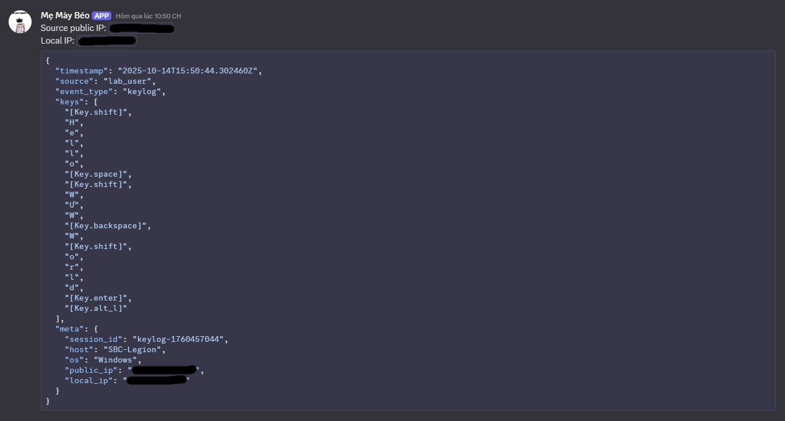

# Keylogger and Clipboard Hijacking (Educational Project)




**⚠️WARNING: THIS PROJECT IS CREATED FOR EDUCATIONAL PURPOSES AND TESTING IN A CONTROLLED LAB ENVIRONMENT ONLY. ABSOLUTELY DO NOT USE FOR ANY OTHER PURPOSE, ESPECIALLY ILLEGAL ACTIVITIES OR PRIVACY VIOLATIONS.**

**I AM NOT RESPONSIBLE FOR ANY MISUSE OF THIS PROJECT.**

## Project Description
This is an educational cybersecurity lab project that simulates how keyloggers and clipboard hijacking work. It includes:
- **Keylogger**: Records keystrokes and sends logs via Discord webhook.
- **Clipboard Hijacking**: Monitors clipboard content (text or images) and sends via Discord webhook.
- **Main Program**: Combines both functions and runs them simultaneously.

The project is written in Python and can be packaged into a single `.exe` file for Windows.

## Directory Structure
```
project_folder/
├── src/
│   ├── key_logger.py        # Keylogger code
│   ├── send_clipboard.py    # Clipboard hijacking code
│   ├── ping_user.py         # User ping code
│   └── send_img.py          # Image sending code
├── main.py                  # Main file to run both functions
├── .env                     # Configuration file containing DISCORD_WEBHOOK_URL
├── requirements.txt         # List of required libraries
├── README.md               # This file
└── liemdai.spec            # PyInstaller configuration file
```

## System Requirements
- **Operating System**: Windows (for `.exe` packaging).
- **Python**: Version 3.8 or higher.
- **Libraries**: Libraries listed in `requirements.txt`.

## Installation
1. **Install Python**:
   - Download and install Python from [python.org](https://www.python.org/downloads/).
   - Make sure to add Python to PATH during installation.

2. **Install libraries**:
   - Open terminal in the project directory and run:
     ```bash
     pip install -r requirements.txt
     ```

   **Contents of requirements.txt:**
   ```
   pynput==1.7.6
   python-dotenv==1.0.1
   requests==2.32.3
   dhooks==1.1.4
   Pillow==10.4.0
   pyperclip==1.9.0
   pyinstaller==6.10.0
   ```

3. **Configure Discord Webhook**:
   - Create a webhook in your Discord channel ([see guide here](https://support.discord.com/hc/en-us/articles/228383668-Intro-to-Webhooks)).
   - Create a `.env` file in the project directory with content:
     ```
     DISCORD_WEBHOOK_URL=your_webhook_url_here
     ```
   - Replace `your_webhook_url_here` with your webhook URL.

## Usage

### 1. Run directly with Python:
- Open terminal in the project directory.
- Run:
  ```bash
  python main.py
  ```
- The program will start both keylogger and clipboard hijacking, sending logs to Discord webhook.
- Press `Ctrl+C` to stop the program.

### 2. Package as .exe file:
- Install PyInstaller if not already installed: `pip install pyinstaller`.
- Run the following command in the project directory:
  ```bash
  pyinstaller liemdai.spec
  ```

- Or run the following command for manual packaging with hidden console:
  ```bash
  pyinstaller --onefile --noconsole --add-data ".env;." --add-data "src/key_logger.py;src" --add-data "src/send_clipboard.py;src" --hidden-import threading --hidden-import pynput.keyboard --hidden-import pynput.mouse --hidden-import PIL.ImageGrab --hidden-import dhooks --hidden-import pyperclip --hidden-import requests --hidden-import python_dotenv --name liemdai main.py
  ```
  > **Note**: For macOS/Linux, replace `;` with `:` in `--add-data`.

- The `.exe` file will be created in the `dist/` directory (e.g., `dist/liemdai.exe`).
- Run the `.exe` file by double-clicking or via command line:
  ```powershell
  .\dist\liemdai.exe
  ```

### 3. Results:
- **Keylogger** will send keystroke logs (every 30 keys) to Discord webhook, including public IP, local IP, and other information.
- **Clipboard hijacking** will send clipboard content (text or images) when changes occur, along with public IP and local IP.

## Ethical and Legal Warning

⚠️ **Purpose of Use**: This project is designed only for educational purposes in a safe lab environment, for example: to study how keyloggers and clipboard hijacking work in Information Security courses.
hijacking
⚠️ **Usage Restrictions**: Absolutely do not use to record other people's data without clear consent, as this violates privacy and may violate the law.

⚠️ **Responsibility**: The user is fully responsible for all actions related to using this source code.

## Troubleshooting

### Common Errors:
- **Missing .env file error**: Make sure the `.env` file exists and contains `DISCORD_WEBHOOK_URL`.
- **Missing library error**: Check the `pip install -r requirements.txt` command again or add `--hidden-import` for missing libraries when packaging (e.g., `--hidden-import requests`).
- **Cannot stop with Ctrl+C in .exe**: If the program doesn't stop, use Task Manager to close or add `--noconsole` option when packaging to run hidden.
- **.exe file won't run**: Run the `.exe` via command line to see error messages and check dependencies/libraries again.

## Author

Project developed for educational purposes in Information Security course.
If you have questions, contact the supervising instructor or lab manager.

---

## ⚠️ FINAL WARNING
**DO NOT USE THIS PROJECT FOR ILLEGAL PURPOSES. I AM NOT RESPONSIBLE FOR ANY CONSEQUENCES FROM MISUSE.**

---

# Vietnamese Version / Phiên bản tiếng Việt

# Keylogger và Clipboard Hijacking (Dự án học tập)

**⚠️LƯU Ý: DỰ ÁN NÀY ĐƯỢC THỰC HIỆN CHỈ VỚI MỤC ĐÍCH HỌC TẬP VÀ THỬ NGHIỆM TRONG MÔI TRƯỜNG LAB KIỂM SOÁT. TUYỆT ĐỐI KHÔNG SỬ DỤNG CHO BẤT KỲ MỤC ĐÍCH KHÁC, ĐẶC BIỆT LÀ CÁC HÀNH VI VI PHẠM PHÁP LUẬT HOẶC XÂM PHẠM QUYỀN RIÊNG TƯ.**

**TÔI KHÔNG CHỊU TRÁCH NHIỆM VỚI BẤT KỲ HÀNH VI SỬ DỤNG SAI MỤC ĐÍCH CỦA DỰ ÁN NÀY.**

## Mô tả dự án
Dự án này là một bài lab học tập về an toàn thông tin, mô phỏng cách hoạt động của keylogger và clipboard hijacking. Nó bao gồm:
- **Keylogger**: Ghi lại các phím bấm và gửi log qua Discord webhook.
- **Clipboard Hijacking**: Theo dõi nội dung clipboard (văn bản hoặc hình ảnh) và gửi qua Discord webhook.
- **Chương trình chính**: Kết hợp cả hai chức năng trên và chạy chúng đồng thời.

Dự án được viết bằng Python và có thể được đóng gói thành một file `.exe` duy nhất để chạy trên Windows.

## Cấu trúc thư mục
```
project_folder/
├── src/
│   ├── key_logger.py        # File chứa mã keylogger
│   ├── send_clipboard.py    # File chứa mã clipboard hijacking
│   ├── ping_user.py         # File chứa mã ping user
│   └── send_img.py          # File chứa mã gửi hình ảnh
├── main.py                  # File chính để chạy cả hai chức năng
├── .env                     # File cấu hình chứa DISCORD_WEBHOOK_URL
├── requirements.txt         # Danh sách thư viện cần thiết
├── README.md               # File này
└── main.spec               # File cấu hình PyInstaller
```

## Yêu cầu hệ thống
- **Hệ điều hành**: Windows (để đóng gói `.exe`).
- **Python**: Phiên bản 3.8 hoặc cao hơn.
- **Thư viện**: Các thư viện được liệt kê trong `requirements.txt`.

## Cài đặt
1. **Cài đặt Python**:
   - Tải và cài đặt Python từ [python.org](https://www.python.org/downloads/).
   - Đảm bảo thêm Python vào PATH trong quá trình cài đặt.

2. **Cài đặt thư viện**:
   - Mở terminal trong thư mục dự án và chạy:
     ```bash
     pip install -r requirements.txt
     ```

   **Nội dung requirements.txt:**
   ```
   pynput==1.7.6
   python-dotenv==1.0.1
   requests==2.32.3
   dhooks==1.1.4
   Pillow==10.4.0
   pyperclip==1.9.0
   pyinstaller==6.10.0
   ```

3. **Cấu hình Discord Webhook**:
   - Tạo một webhook trong kênh Discord của bạn ([xem hướng dẫn tại đây](https://support.discord.com/hc/en-us/articles/228383668-Intro-to-Webhooks)).
   - Tạo file `.env` trong thư mục dự án với nội dung:
     ```
     DISCORD_WEBHOOK_URL=your_webhook_url_here
     ```
   - Thay `your_webhook_url_here` bằng URL webhook của bạn.

## Cách sử dụng

### 1. Chạy trực tiếp bằng Python:
- Mở terminal trong thư mục dự án.
- Chạy:
  ```bash
  python main.py
  ```
- Chương trình sẽ khởi động cả keylogger và clipboard hijacking, gửi log đến Discord webhook.
- Nhấn `Ctrl+C` để dừng chương trình.

### 2. Đóng gói thành file .exe:
- Cài đặt PyInstaller nếu chưa có: `pip install pyinstaller`.
- Chạy lệnh sau trong thư mục dự án:
  ```bash
  pyinstaller liemdai.spec
  ```

- Hoặc chạy lệnh sau nếu muốn đóng gói thủ công và chạy ẩn console:
  ```bash
  pyinstaller --onefile --noconsole --add-data ".env;." --add-data "src/key_logger.py;src" --add-data "src/send_clipboard.py;src" --hidden-import threading --hidden-import pynput.keyboard --hidden-import pynput.mouse --hidden-import PIL.ImageGrab --hidden-import dhooks --hidden-import pyperclip --hidden-import requests --hidden-import python_dotenv --name liemdai main.py
  ```
  > **Lưu ý**: Nếu dùng macOS/Linux, thay `;` bằng `:` trong `--add-data`.

- File `.exe` sẽ được tạo trong thư mục `dist/` (ví dụ: `dist/liemdai.exe`).
- Chạy file `.exe` bằng cách nhấp đúp hoặc qua command line:
  ```powershell
  .\dist\liemdai.exe
  ```

### 3. Kết quả:
- **Keylogger** sẽ gửi log phím bấm (mỗi 30 phím) đến Discord webhook, bao gồm public IP, local IP, và các thông tin khác.
- **Clipboard hijacking** sẽ gửi nội dung clipboard (văn bản hoặc hình ảnh) khi có thay đổi, kèm theo public IP và local IP.

## Cảnh báo đạo đức và pháp lý

⚠️ **Mục đích sử dụng**: Dự án này chỉ được thiết kế cho mục đích học tập trong môi trường lab an toàn, ví dụ: để nghiên cứu cách hoạt động của keylogger và clipboard hijacking trong môn An toàn thông tin.

⚠️ **Hạn chế sử dụng**: Tuyệt đối không sử dụng để ghi lại dữ liệu của người khác mà không có sự đồng ý rõ ràng, vì điều này vi phạm quyền riêng tư và có thể vi phạm pháp luật.

⚠️ **Trách nhiệm**: Người sử dụng chịu hoàn toàn trách nhiệm cho mọi hành vi liên quan đến việc sử dụng mã nguồn này.

## Khắc phục sự cố

### Các lỗi thường gặp:
- **Lỗi thiếu file .env**: Đảm bảo file `.env` tồn tại và chứa `DISCORD_WEBHOOK_URL`.
- **Lỗi thiếu thư viện**: Kiểm tra lại lệnh `pip install -r requirements.txt` hoặc thêm `--hidden-import` cho thư viện bị thiếu khi đóng gói (ví dụ: `--hidden-import requests`).
- **Lỗi không dừng bằng Ctrl+C trong .exe**: Nếu chương trình không dừng, sử dụng Task Manager để tắt hoặc thêm tùy chọn `--noconsole` khi đóng gói để chạy ẩn.
- **File .exe không chạy**: Chạy `.exe` qua command line để xem thông báo lỗi và kiểm tra lại các file/thư viện phụ thuộc.

## Tác giả

Dự án được phát triển cho mục đích học tập trong môn An toàn thông tin.
Nếu có thắc mắc, liên hệ với giáo viên hướng dẫn hoặc người quản lý lab.

---

## ⚠️ CẢNH BÁO CUỐI CÙNG
**KHÔNG SỬ DỤNG DỰ ÁN NÀY CHO MỤC ĐÍCH BẤT HỢP PHÁP. TÔI KHÔNG CHỊU TRÁCH NHIỆM CHO BẤT KỲ HẬU QUẢ NÀO TỪ VIỆC SỬ DỤNG SAI MỤC ĐÍCH.**